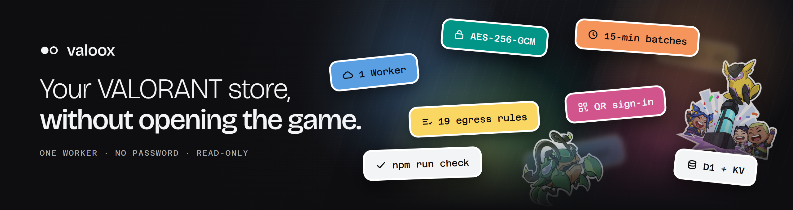
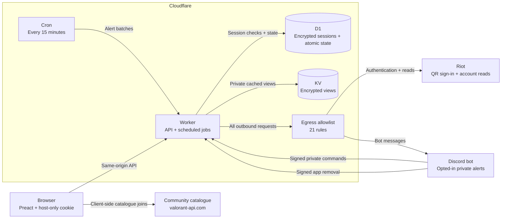

# valoox

Your VALORANT daily store and collection, on your phone, without opening the
game. Sign in with Riot Mobile's QR flow; the app never asks for your password.

**[Open the app](https://drop.valoox.store)** · [Architecture](#architecture)
· [Security and limitations](SECURITY.md) · [Design](DESIGN.md)

## Features

- Daily offers, night market, bundles and accessories, with owned items marked.
- Share daily offers as a PNG with your equipped banner and Riot ID. Portrait and
  compact formats are generated in your browser, with an optional hidden tag.
  The tag choice follows the verified Riot account across devices and is checked
  each time sharing opens; it is removed after the last session ends.
  Supported phones open the native share menu; other browsers offer image download.
- Store rotations refresh automatically when any countdown expires or when an
  expired tab becomes visible again. After eight unsuccessful automatic attempts,
  requests stop and manual retry remains available. Fresh data resumes the scheduler.
- Missing bundle metadata gets up to six catalogue attempts while visible and online.
  Reopening that screen starts another bounded attempt sequence.
- Weapon skins, variants, sprays, buddies, cards and titles in your collection.
- Known rewards are hidden from unowned catalogue lists; owned rewards remain visible.
- Dark Alerts and Account screens, with guided Discord linking and disconnect confirmations.
- Wishlist alerts by Discord DM, available once the bot is configured.
  Batches run every fifteen minutes outside the first half hour of each UTC day.
  Lists are grouped by account and destination. Discord verifies a separate bot
  DM and stops after four delivery attempts or payload expiry.
- One encrypted wishlist per verified Riot account, shared across devices.
  Device edits merge their own additions and removals; returning to the app refreshes
  the list without polling Riot. The list is removed after the last session ends.
- Guided Discord setup, profile pictures and weapon images in alert messages.
  Connected profiles hide setup controls; checking blocks conflicting actions.
- Message cards use the language selected by the connecting valoox page. Compact
  setup instructions put copying first, then opening Discord to paste and send.

One Cloudflare Worker serves a Preact app, with D1 for sessions and atomic state
and KV for encrypted views. Riot sessions use purpose-bound AES-256-GCM keys;
D1 checks authentication and revocation before private cache reads. Every
outbound request passes the [21-rule allowlist](src/vault/upstream.ts), which
excludes Riot purchases, equipping and chat. The browser joins the community
catalogue; code, fonts and fixed artwork are served from the app's own origin.
Catalogue data, item artwork and clips use narrowly allowed external hosts.

English is the source and fallback language. A Spanish browser preference selects
the Spanish translation. Discord connections retain the valoox page's language,
independent of Discord's locale; opening an existing connection updates its language.

## Architecture



Wishlist notifications use the Discord bot's private messages.
D1 authorizes private cache reads. Sessions and views are encrypted by the Worker
with purpose-bound keys derived from `JAR_KEY`, which stays outside the databases.
[Open the interactive architecture](docs/architecture.html) for source links
and the detailed session flow.

## Local development

Use Node 24 or newer. Copy [.dev.vars.example](.dev.vars.example) to `.dev.vars`
and fill in `JAR_KEY` with 32 random bytes encoded as base64. Discord alerts are
optional; configure the bot settings below to enable them.

```sh
npm ci
npm run fonts
npm run art
npm run migrate -- --local
npm run dev
```

`npm run check` runs type checks, lint, tests and the browser build.
Source contracts require fewer than 200 lines per authored file and reject runtime
module cycles. Generated bundles, the Archify export/model and measured palette
data are excluded. Application code, scripts, tests and configuration are covered.
QR polling stops on approval, expiry, unmount, or ten minutes of unsuccessful reads.
CI checks stop after ten minutes; deployments stop after twenty minutes.

`npm run who` reads aggregate current-version session counts from live D1;
`npm run who -- local` uses local D1. Session writes, including background alerts,
are reported as updates, not page visits. Legacy rows are listed separately.
`npm run phone` serves local development over Tailscale HTTPS;
`npm run phone:off` removes it. Keep the connection private; never use Funnel.

## Deploy your own copy

[](https://deploy.workers.cloudflare.com/?url=https://github.com/NicolasV7/valoox)

The button provisions resources in your own account. For manual setup, create
the bindings below and replace the default placeholder IDs in `wrangler.toml`:

```sh
npx wrangler d1 create val-sessions
npx wrangler kv namespace create VAL
npx wrangler secret put JAR_KEY
npm run deploy
```

The default environment uses a separate Worker on `workers.dev`. Both deploy
scripts apply versioned D1 migrations before publishing. `npm run deploy:live`
targets this project's `val` Worker and custom domains; use it only with the
corresponding account, bindings and secrets.

| Worker setting | Purpose |
| --- | --- |
| `JAR_KEY` | Required secret: 32 random bytes, base64. Rotation invalidates existing sessions and encrypted state. |
| `DISCORD_APP_ID` | Optional Discord Application ID; stored as a Worker secret to preserve deployment settings. |
| `DISCORD_PUBLIC_KEY` | Discord Ed25519 verification key, stored with Worker secrets. Public, but must match the application. |
| `DISCORD_TOKEN` | Optional bot token; required with both settings above to enable Discord linking. |

Use `npx wrangler secret put <NAME>` for your own default deployment, or append
`--env live` for this project's production environment. Worker secrets belong
in Cloudflare; local equivalents belong in the ignored `.dev.vars` file.

### Discord private alerts

1. Create a bot application in [Discord Developer Portal](https://discord.com/developers/applications).
   Enable User Install and Guild Install. For User Install, enable `applications.commands`;
   for Guild Install, enable `bot` and `applications.commands`. No privileged intents are needed.
2. Copy Application ID and Public Key from General Information and the token from Bot.
   Save them as `DISCORD_APP_ID`, `DISCORD_PUBLIC_KEY` and `DISCORD_TOKEN` using
   `npx wrangler secret put <NAME> --env live`. Keep local equivalents in `.dev.vars`.
3. Set the Interactions Endpoint URL to `https://<your-app-host>/api/hook/discord`.
   Run `npm run discord:check`, then `npm run discord:register` with matching local settings.
   On Webhooks, set `https://<your-app-host>/api/hook/discord/events` and subscribe
   to Application Deauthorized so removing the app also stops its linked alerts.
4. In Alerts, choose Discord and authorize the app once. Return to copy the
   prepared command and open the bot's DM. Send `/connect code:<code>` there
   within ten minutes. A separate bot message must
   succeed before the connection becomes active. `/status` checks it; `/stop`
   disables Discord alerts across all linked browsers. Browser removal affects only that browser.

Only direct messages are supported; arbitrary Discord webhooks and server channels
cannot be configured. Verify delayed proactive DMs with your installation before
advertising a server-free flow. If Discord denies a DM, linking stays inactive;
an existing connection is paused on a later permanent refusal.
Discord nonce deduplication lasts only a few minutes; after a lost HTTP response,
a delayed retry can duplicate a message. We do not claim exactly-once delivery.

### GitHub Actions

Add repository Actions secrets named `CLOUDFLARE_API_TOKEN` and
`CLOUDFLARE_ACCOUNT_ID`. The token needs access to deploy Workers, use the configured
KV binding, apply D1 migrations and manage the configured zone's Workers routes.
Scope it to the deployment account and zone.

The [Deploy workflow](.github/workflows/deploy.yml) runs on pushes to `main` or
manual dispatch. It skips deployment when the token is absent. Successful runs
check the code, attest `public/app.js`, apply live migrations and deploy.
The Account screen links to the browser build's source commit. Verify a CI-built
browser bundle with:

```sh
curl -sO https://drop.valoox.store/app.js
gh attestation verify app.js --repo NicolasV7/valoox
```

The attestation covers the browser bundle. It does not attest the running Worker.
Disconnecting removes this app's access; it does not revoke Riot's session or
erase Cloudflare backup history. See [SECURITY.md](SECURITY.md) for retention and
the remaining limits.

## License and artwork

[AGPL-3.0](LICENSE). See [PRODUCT.md](PRODUCT.md) for project identity and fork
guidance. Not affiliated with Riot Games. VALORANT and its artwork, including
the banner's sprays, belong to Riot Games, Inc.

The banner source is [design/banner.html](design/banner.html). After fetching
fonts and artwork, `npm run banner` renders its PNG using local Chrome or Edge.
