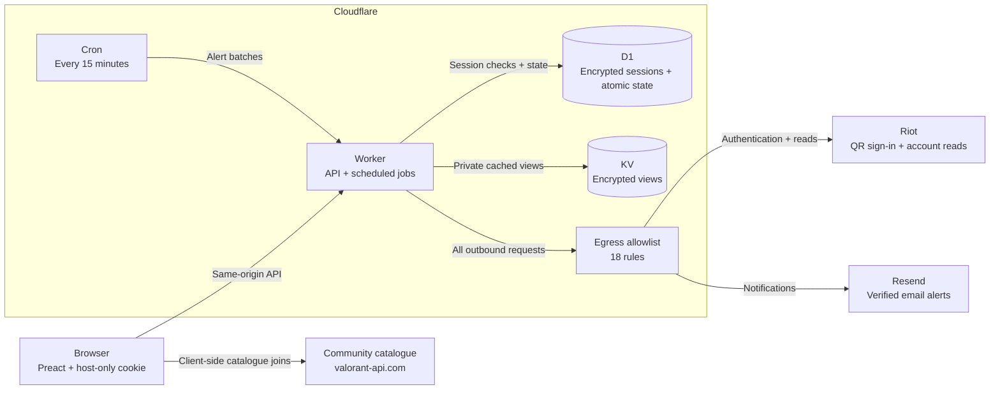

# valoox

Your VALORANT daily store and collection, on your phone, without opening the
game. Sign in with Riot Mobile's QR flow; the app never asks for your password.

**[Open the app](https://drop.valoox.store)** · [Architecture](#architecture)
· [Security and limitations](SECURITY.md) · [Design](DESIGN.md)

## Features

- Daily offers, night market, bundles and accessories, with owned items marked.
- Weapon skins, variants, sprays, buddies, cards and titles in your collection.
- Known rewards are hidden from unowned catalogue lists; owned rewards remain visible.
- Dark Alerts and Account screens, including email removal and disconnect confirmations.
- Wishlist alerts by verified email. Batches run every fifteen
  minutes outside the first half hour of each UTC day. Lists are grouped by
  account and destination; email retries use Resend idempotency.

One Cloudflare Worker serves a Preact app, with D1 for sessions and atomic state
and KV for encrypted views. Riot sessions use purpose-bound AES-256-GCM keys;
D1 checks authentication and revocation before private cache reads. Every
outbound request passes the [18-rule allowlist](src/vault/upstream.ts), which
excludes purchases, equipping and chat. The browser joins the community
catalogue; code, fonts and fixed artwork are served from the app's own origin.
Catalogue data, item artwork and clips use narrowly allowed external hosts.

English is the source and fallback language. A Spanish browser preference selects
the Spanish translation, including emails requested from that tab.

## Architecture



The diagram follows the email notification flow exposed by the app.
D1 authorizes private cache reads. Sessions and views are encrypted by the Worker
with purpose-bound keys derived from `JAR_KEY`, which stays outside the databases.
[Open the interactive architecture](docs/architecture.html) for source links
and the detailed session flow.

## Local development

Use Node 24 or newer. Copy [.dev.vars.example](.dev.vars.example) to `.dev.vars`
and fill in `JAR_KEY` with 32 random bytes encoded as base64. Email is optional.

```sh
npm ci
npm run fonts
npm run art
npm run migrate -- --local
npm run dev
```

`npm run check` runs type checks, lint, tests and the browser build.
`npm run phone` serves local development over Tailscale HTTPS;
`npm run phone:off` removes it. Keep the connection private; never use Funnel.

## Deploy your own copy

[](https://deploy.workers.cloudflare.com/?url=https://github.com/NicolasV7/valoox)

The button provisions resources in your own account. For manual setup, create
the bindings below and replace the default placeholder IDs in `wrangler.toml`:

```sh
npx wrangler d1 create val-sessions
npx wrangler kv namespace create VAL
npx wrangler secret put JAR_KEY
npm run deploy
```

The default environment uses a separate Worker on `workers.dev`. Both deploy
scripts apply versioned D1 migrations before publishing. `npm run deploy:live`
targets this project's `val` Worker and custom domains; use it only with the
corresponding account, bindings and secrets.

| Worker setting | Purpose |
| --- | --- |
| `JAR_KEY` | Required secret: 32 random bytes, base64. Rotation invalidates existing sessions and encrypted state. |
| `RESEND_KEY` | Optional sending-only API key restricted to your verified sending domain. |
| `RESEND_HOOK` | Webhook signing secret required to accept Resend delivery events. |
| `MAIL_FROM` | Plain variable: a sender address on your verified domain. Change it for your own deployment. |

### Email with Resend

1. [Verify your sending domain](https://resend.com/docs/dashboard/domains/introduction)
   and set `MAIL_FROM` to an address on it.
2. Create a [sending-only API key](https://resend.com/docs/api-reference/api-keys/create-api-key)
   restricted to that domain; save it as the Worker's `RESEND_KEY` secret.
3. Add `https://<your-app-host>/api/hook/resend` as a
   [Resend webhook](https://resend.com/docs/webhooks/introduction). Subscribe to
   email events and save its signing secret as `RESEND_HOOK`.
4. In the app, open Alerts and verify the recipient address with the emailed code.

Use `npx wrangler secret put <NAME>` for your own default deployment, or append
`--env live` for this project's production environment. Worker secrets belong
in Cloudflare; local equivalents belong in the ignored `.dev.vars` file.

### GitHub Actions

Add repository Actions secrets named `CLOUDFLARE_API_TOKEN` and
`CLOUDFLARE_ACCOUNT_ID`. The token needs access to deploy Workers, use the configured
KV binding, apply D1 migrations and manage the configured zone's Workers routes.
Scope it to the deployment account and zone.

The [Deploy workflow](.github/workflows/deploy.yml) runs on pushes to `main` or
manual dispatch. It skips deployment when the token is absent. Successful runs
check the code, attest `public/app.js`, apply live migrations and deploy.
The Account screen links to the browser build's source commit. Verify a CI-built
browser bundle with:

```sh
curl -sO https://drop.valoox.store/app.js
gh attestation verify app.js --repo NicolasV7/valoox
```

The attestation covers the browser bundle. It does not attest the running Worker.
Disconnecting removes this app's access; it does not revoke Riot's session or
erase Cloudflare backup history. See [SECURITY.md](SECURITY.md) for retention and
the remaining limits.

## License and artwork

[AGPL-3.0](LICENSE). See [PRODUCT.md](PRODUCT.md) for project identity and fork
guidance. Not affiliated with Riot Games. VALORANT and its artwork, including
the banner's sprays, belong to Riot Games, Inc.

The banner source is [design/banner.html](design/banner.html). After fetching
fonts and artwork, `npm run banner` renders its PNG using local Chrome or Edge.
